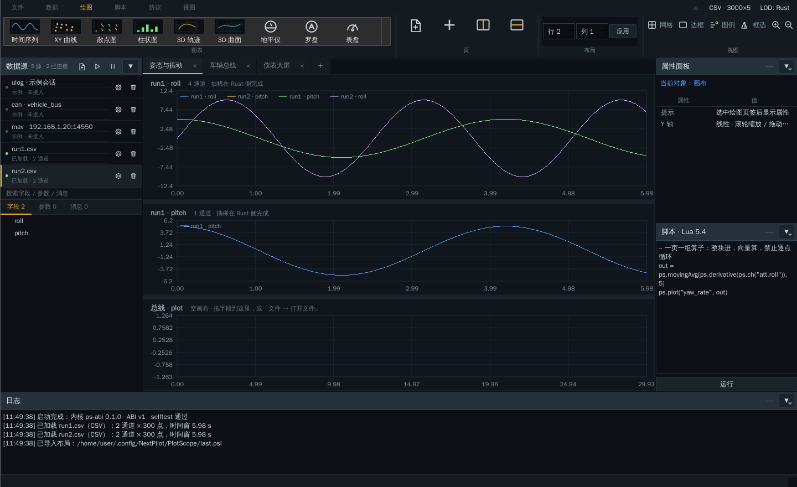

# PlotScope

PlotScope 是一个面向无人机、嵌入式与车辆研发的桌面日志分析工具。它把飞行日志、CAN 总线和通用 CSV 放到同一个工作区里，用于多架次/多次仿真对比、时间轴对齐、曲线叠加和常用数据变换。

当前版本以**离线日志分析**为主，不对外承诺未实测的性能数字。



## 能做什么

### 多源对比
- 同时打开多份记录，每个数据源独立持有通道、参数和消息。
- 源可重命名；同一通道来自不同源时，图例显示为 `源别名 · 通道名`。
- 支持起点、中心、终点对齐，也可手动设置时间偏移；偏移随布局保存。
- 一键“对比同名通道”，把两个源的同一字段叠到当前画布。

### 日志加载
| 格式 | 说明 |
|---|---|
| PX4 ULog `.ulg` | 按 topic/field 展开通道，可查看参数表 |
| ArduPilot DataFlash `.bin` | 按 `ATT.Roll` 等消息/字段展开，读取 FMTU 单位与 PARM 参数 |
| Vector CAN `.asc` / `.blf` | 无 DBC 时输出报文字节原始值与周期，不做物理量猜测 |
| CSV / TSV / TXT | 自动探测分隔符、表头和时间列；支持行号、指定时间列、日期+时间列合并 |

加载器由 schema 驱动，新增格式不需要在 app 里单独写对话框。

### 绘图
- 图型画廊覆盖时间序列、XY、散点、柱状、直方图、频谱 FFT、3D 轨迹、地平仪、罗盘、表盘；新建图页会沿用当前画布的可见通道。
- Ribbon + 可停靠面板 + 页签绘图区；面板支持拖动停靠、浮动、自动隐藏。
- 画布可向右/向下任意拆分，也可用 `m × n` 一次性铺好再继续拆。
- 网格、边框、图例、框选缩放、滚轮缩放、拖动平移、双击复位。
- 十字游标逐曲线显示当前值；A/B 游标显示 `Δt`、逐曲线 `Δy` 与斜率。
- 单画布可导出 PNG，或导出当前可见时间窗的 CSV 长表。

### 数据变换
- 绝对值、比例/偏移/时间平移、微分、梯形积分、滑动平均、滑动 RMS、滑动方差/标准差、尖峰剔除、阈值二值化、样本计数、相邻样本 Δt。
- 四元数 `w/x/y/z` 一次生成 `roll/pitch/yaw` 三条派生通道。
- 变换前可预览 before/after，应用后替换来源曲线并继承颜色；变换配方随 `.psl` 保存。

### 脚本
- 内置 Lua 5.4 脚本面板，提供 `ps.ch`、`ps.time`、`ps.plot`、`ps.movingAvg`、`ps.derivative`、`ps.integral`、`ps.scale`。
- 脚本在受限沙箱中运行：无 `os/io/package/debug`，带指令预算与内存上限；输出直接追加到当前工作区画布。

### 工作区
- 多绘图页、页内自由切分布局、数据源/属性/脚本/日志停靠面板。
- `.psl` 保存数据源路径、别名、时间偏移、画布布局、图型与派生配方，启动时可恢复。

## 当前边界

以下能力尚未完成，README 不把它们写成已支持：

- 3D 曲面、GPS 地图尚未实现；3D 轨迹是轻量正交投影，不是完整 3D 引擎。
- 脚本输出不写回 `.psl`，重启后不会恢复。
- MAVLink、ROS1/ROS2、MCAP、MDF4、GNSS 原始解析、实时流与实时记录未接入。
- 插件目前是宿主内注册，外部 `.json` manifest + 动态库 ABI 尚未实现。
- `.psl` 仍是 JSON v1，未迁移到 PJ4 的 XML 工作区格式。

## 构建

依赖：CMake ≥ 3.22、Qt 6 Widgets、Rust 工具链（`cargo` 在 `PATH` 或通过 `-DPS_CARGO=` 指定）。

```bash
cmake -S . -B build -DCMAKE_BUILD_TYPE=Release
cmake --build build -j
ctest --test-dir build --output-on-failure
./build/src/app/plotscope_app
```

只构建 Rust 内核、不构建 GUI：

```bash
cmake -S . -B build -DPS_BUILD_GUI=OFF
cmake --build build -j
```

## 目录

```text
src/app/        Qt 6 主程序：Ribbon、Dock、画布、变换、加载器
src/kernel/     Rust 内核，产出 C ABI（ps_kernel.h）
src/3rdparty/   锁版本三方库（SARibbon 等）
docs/          设计文档、PJ 对齐笔记、原型与截图
```

## 文档

- `docs/PlotScope-架构设计与PJ4实施-定稿-v1.0.md`：架构决策、模块边界、P/M 计划与实施进度。
- `docs/PlotScope-PJ4对齐与源码核对-v1.1.md`：PJ3/PJ4 能力矩阵与源码核对。
- `docs/prototype/PlotScope-工作区原型.html`：单文件 UI 原型，浏览器直接打开。

## 许可

BSD-3-Clause。三方库许可见 `docs/` 与安装包 `third-party/`。
