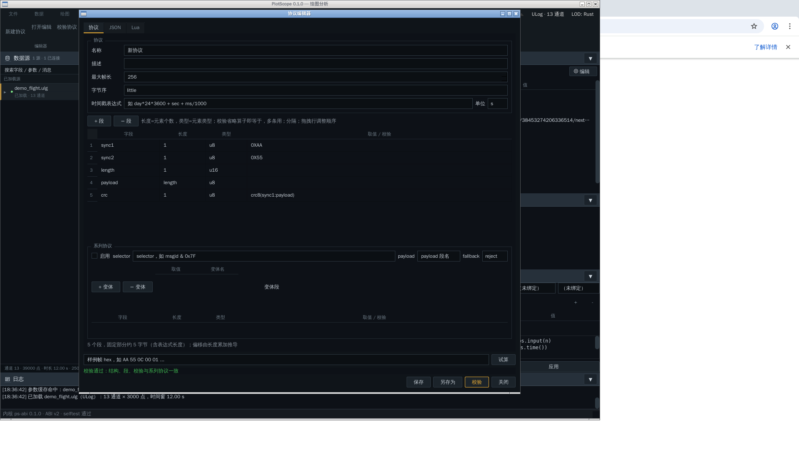
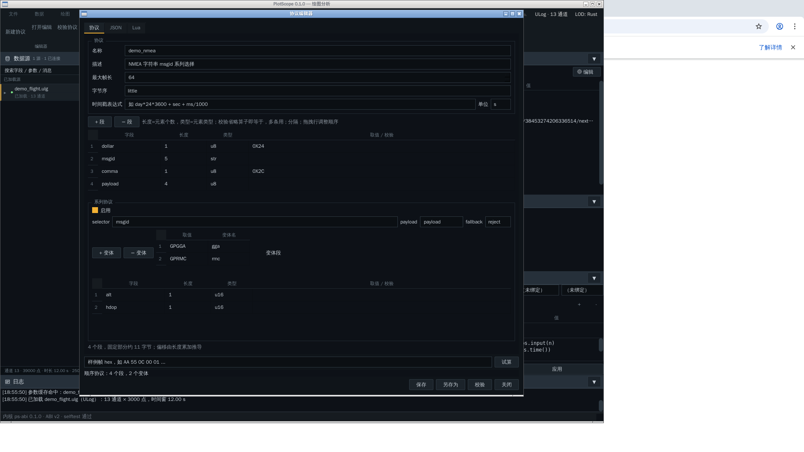

# PlotScope 通用帧协议规范 v1

> 状态：方案定稿，加载端与编辑器按本规范实现。
> 适用范围：嵌入式、飞控、私有二进制帧协议；支持变长、任意同步字位置、字段约束、系列协议和时间戳表达式。

## 1. 设计原则

- 协议不是“字节偏移表”，而是**有序段列表**。段偏移由前面的段宽累加推导。
- 每个段是数组：`size` 是**元素个数**，`type` 是元素类型；字节数 = `size * sizeof(type)`。
- 长度、校验、时间戳、系列选择器都使用同一套安全表达式。
- JSON 是权威格式；Lua 是描述投影。
- 旧 `layout:"offset"` 协议继续可加载，新协议统一用 `layout:"sequential"`。

## 2. 顶层结构

```json
{
  "version": 1,
  "name": "demo",
  "description": "示例协议",
  "layout": "sequential",
  "endian": "little",
  "maxsize": 4096,
  "timestamp": {
    "expr": "time_s",
    "unit": "s",
    "origin": "first_frame",
    "raw": false,
    "fallback": "reject"
  },
  "segments": [],
  "series": {}
}
```

| 键 | 必填 | 说明 |
|---|---|---|
| `version` | 否 | 格式版本 |
| `name` | 是 | 协议名 |
| `description` | 否 | 协议描述 |
| `layout` | 是 | `sequential` 或旧 `offset` |
| `endian` | 否 | 默认字节序，`little` / `big`，默认 little |
| `maxsize` | 否 | 单帧最大字节数，默认 4096 |
| `timestamp` | 否 | 整帧时间戳表达式 |
| `segments` | 是 | 有序段列表 |
| `series` | 否 | 系列协议 |

不保留 `meta`。厂商、方向等信息写进 `description`。

## 3. 段

```json
{
  "name": "payload",
  "size": "length",
  "type": "u8",
  "role": "payload",
  "value": "0xAA",
  "checks": [],
  "hidden": false,
  "plot": true,
  "scale": 1,
  "offset": 0,
  "unit": "V",
  "description": "负载"
}
```

| 属性 | 必填 | 说明 |
|---|---|---|
| `name` | 是 | 段名，协议内唯一 |
| `size` | 是 | 元素个数；常量、字段引用或表达式 |
| `type` | 是 | 元素类型 |
| `endian` | 否 | 覆盖默认字节序 |
| `role` | 否 | `sync/length/payload/checksum/data`，默认 `data` |
| `value` | 否 | `eq` 语法糖，按原始值比较 |
| `checks` | 否 | 校验算子数组 |
| `hidden` | 否 | 不输出通道 |
| `plot` | 否 | 显式控制绘图 |
| `scale` | 否 | 物理值系数，默认 1 |
| `offset` | 否 | 物理值偏移，默认 0 |
| `unit` | 否 | 单位 |
| `description` | 否 | 段说明 |
| `bit` / `bits` | 否 | 位域，仅固定宽度段兼容使用 |

规则：

- `size` 求值必须是正整数。
- `size` 可引用前序段，禁止循环。
- 段字节数 = `size * typeSize`。
- 段偏移 = 前面所有段字节数累加。
- `value` 与显式 `eq` 不能同时出现。

## 4. 类型

| 类型 | 元素字节数 |
|---|---|
| `u8` / `i8` | 1 |
| `u16` / `i16` | 2 |
| `u32` / `i32` | 4 |
| `u64` / `i64` | 8 |
| `f32` | 4 |
| `f64` | 8 |
| `bool` | 1 |
| `bcd` | 由 `size` 决定，按 BCD 解码 |
| `str` / `string` / `ascii` / `char` | 1 字符 1 字节，按 ASCII 字节拼接 |

`str` 的 `size` 是字符个数，例如 NMEA 的 `msgid` 写 `"size": 5, "type": "str"`。字符串段只参与 `selector` 与 `over` 字节拼接，不生成数值绘图通道。

`payload` 用 `u8` 数组表达，不另设 `bytes` 类型。

## 5. 表达式

`size`、`value`、`checks`、`timestamp` 的数值部分共用一套表达式引擎；`series.selector` 可以是数值表达式，也可以直接引用一个 `str` 段（如 NMEA 的 `msgid`），字符串不做算术。

语法：

- 十进制、`0x` 十六进制
- 段引用：`name`
- 数组元素：`name[index]`
- 算术：`+ - * / %`
- 位运算：`& | ^ << >>`
- 一元 `-`
- 括号
- 函数：`min/max/abs/clamp`

语义：

- 整数运算；`/` 向零截断，`%` 取余。
- 编译期解析 AST，禁止 `eval`。
- AST 深度 ≤ 32。
- 引用必须指向前序段。
- 结果非法（0、负数、越界、除零、NaN/Inf）整帧拒绝。

## 6. 校验

```json
"checks": [
  {"op": "eq", "expr": "length - 4"},
  {"op": "crc16", "over": ["sync1", "payload"], "poly": "0x1021", "init": "0xFFFF"}
]
```

### 6.1 值谓词

| 算子 | 参数 | 说明 |
|---|---|---|
| `eq` | `value` 或 `expr` | 等于；可省略算子名 |
| `ne` | `value` / `expr` | 不等于 |
| `lt/le/gt/ge` | `value` / `expr` | 比较 |
| `in` | `values` | 枚举命中 |
| `range` | `min` / `max` | 闭区间 |
| `mask` | `and` / `eq` | 掩码后比较 |
| `scope` | `element` / `array` | 数组校验范围，默认 element |

### 6.2 序列算子

| 算子 | 输出字节 | 说明 |
|---|---|---|
| `crc8` | 1 | 默认 poly 0x07，init 0x00 |
| `crc16` | 2 | 默认 poly 0x1021，init 0xFFFF |
| `crc32` | 4 | 默认 IEEE |
| `sum8` | 1 | 8 位截断 |
| `sum16` | 2 | 16 位截断 |
| `xor8` | 1 | 逐字节异或 |
| `parity` | 1 | 奇偶校验 |

CRC 参数：`poly/init/refin/refout/xorout`。

`over` 语义：

- 按列表顺序取各段全部原始字节。
- 段在帧内可不连续，自动拼接。
- 数组段按元素顺序展开。
- 校验段宽度必须等于算子输出字节数。
- 支持区间写法 `"sync1:payload"`：按 `segments` 声明顺序，从 `sync1` 到 `payload`（含两端）的所有段。
- 区间可与显式段名混用：`["sync1:payload", "tail"]`。
- 区间方向必须与声明顺序一致；反向或跨系列变体区间直接报错。
- `payload` 在区间中始终表示 payload 原始字节区，即使系列已命中、绘图时被变体替换。
- 重复段只计一次。

示例：

```json
{"op":"crc8", "over":["sync1:payload"]}
{"op":"crc16", "over":["sync1:sync2", "payload", "tail"]}
```

## 7. 数组校验

- `size=1`：谓词作用于该元素。
- `size>1`：`eq/ne/range/in/mask` 默认逐元素校验，全部通过才算通过。
- `crc/sum/xor` 作用于整个段的原始字节流。

## 8. 长度段 `counts`

```json
{
  "name": "length",
  "size": 1,
  "type": "u16",
  "role": "length",
  "counts": {"fields": ["payload"], "unit": "bytes"}
}
```

- `fields` 被计量的段。
- `unit`：`elements` 或 `bytes`，默认 `elements`。
- 加载器反算实际值必须一致。
- 支持表达式：`counts.expr`，用于长度包含帧头等情况。

## 9. 时间戳 `timestamp`

```json
"timestamp": {
  "expr": "day * 24 * 3600 + sec + ms / 1000",
  "unit": "s",
  "origin": "first_frame",
  "raw": false,
  "fallback": "reject"
}
```

| 属性 | 说明 |
|---|---|
| `expr` | 时间表达式 |
| `unit` | `s/ms/us`，统一归一成秒 |
| `origin` | `first_frame` 首帧为 0；`absolute` 绝对时间 |
| `raw` | `false` 用物理值，`true` 用原始值 |
| `fallback` | `reject` 拒绝整帧；`index` 用帧序号 |

- 在字段解析、校验、变体展开之后求值。
- 支持数组下标。
- 无 `timestamp` 时用帧序号。

## 10. 系列协议

```json
"series": {
  "selector": "msgid & 0x7F",
  "payload": "payload",
  "fallback": "reject",
  "variants": [
    {"value": 1, "name": "att", "segments": []},
    {"values": [2, 3], "name": "env", "segments": []}
  ]
}
```

| 键 | 说明 |
|---|---|
| `selector` | 数值表达式（结果为整数），或直接引用 `str` 段 |
| `payload` | 公共段中的 payload 段名 |
| `fallback` | `reject` 或 `raw` |
| `variants[].value/values` | 选择值；数值协议的变体用数字，NMEA 这类字符串协议用 `"GPGGA"` / `"GPRMC"` |
| `variants[].name` | 变体名，用于通道前缀 |
| `variants[].segments` | 变体字段，替换 payload |

规则：

- 变体段总字节数必须等于 payload 字节数。
- 系列命中时，不画原始 payload，按变体段画。
- 系列未命中：`reject` 整帧拒绝；`raw` 按原始 payload 画。
- 无 series 时，payload 始终按原始数组画。
- 通道名：`frame.<变体名>.<字段>`。
- 只支持一层系列。
- `selector` 直接引用 `str` 段时，按完整字符串比较，例如：
  ```json
  "selector": "msgid",
  "variants": [{"value": "GPGGA", "name": "gga", "segments": []},
               {"value": "GPRMC", "name": "rmc", "segments": []}]
  ```

## 11. 绘图

- `size=1`：`frame.name`。
- `size>1`：`frame.name[0] … frame.name[n-1]`。
- `payload` 无 series：`frame.payload[i]`。
- `payload` 有 series 且命中：按变体段。
- 数组通道上限 256，超出只画前 256 并告警。
- `hidden` / `plot:false` 不画。
- `scale/offset/unit` 应用于通道物理值。

## 12. 加载器流程

1. 解析模板，编译 IR：段表、size AST、checks AST、timestamp AST、series。
2. 扫描候选帧：先比较 `role:sync` 常量；失败前进 1 字节。
3. 按段顺序求 size，累计字节偏移。
4. 解析原始值，执行值谓词和序列校验。
5. `counts` 反算。
6. 按 `selector` 选择变体，展开 payload。
7. 求 `timestamp`。
8. 解码通道，跳到下一帧。

限制：

- 单帧 ≤ `maxsize`。
- 段数 ≤ 256，变体数 ≤ 256。
- 每段 checks ≤ 32。
- AST 深度 ≤ 32。

## 13. 编辑器

协议文件 `.psproto` 归 app 所有，加载插件只执行协议。Ribbon 提供三个入口：

- **新建协议**：在 app config `protocols/` 下生成带时间戳的 `new-yyyyMMdd-HHmmss.psproto`，写入空白顺序协议并打开。
- **打开编辑**：选择已有 `.psproto`，进入同一编辑器。
- **校验协议**：不打开对话框，直接做结构校验，结果用信息框/详情展示。

编辑器内“校验”按钮与保存前检查共用一套规则。

- 顶部：协议名、描述、`maxsize`、字节序、时间戳表达式与单位。
- 段表四列：字段 / 长度 / 类型 / 取值校验。
- “长度”是元素个数，可填表达式；“类型”是元素类型。
- “取值校验”支持省略 `eq`，多条用 `;`；序列算子写 `crc8(sync1:payload)`。
- 段表下方统一维护角色：按名称识别 `sync` / `length` / `payload` / `checksum`，其余为 `data`。
- 系列区：启用开关、`selector`（数值表达式或 `str` 段名）、`payload` 段、`fallback`、变体列表与变体段表；变体取值支持数字或字符串。
- 变体段表同样是“字段 / 长度 / 类型 / 取值校验”四列，可直接编辑。
- 类型列接受 `u8…f64 / bool / bcd / str` 等协议类型；`str` 的“长度”是字符数。
- `sync` 可以有多个，`length / payload / checksum` 各自只能有一个。
- “试算”按字面长度逐段显示偏移和原始字节；遇到表达式长度时提示变长并停止。
- JSON 页可直接手改并回灌；Lua 页由当前段表实时生成。
- 协议页是 `layout:"sequential"` 的主编辑入口，旧设计页/系列页在该模式下隐藏。





## 14. 兼容

- 旧 `layout:"offset"` 继续加载。
- 旧字段级 `"time": true` 兼容读取。
- 编辑旧协议时提示转换；位域保留“位域”高级页。
- 新协议默认 `layout:"sequential"`。
